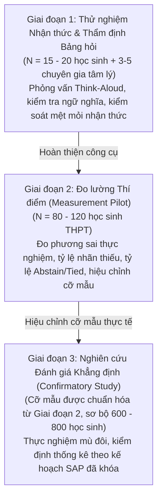

# Đề cương Nghiên cứu Đánh giá Độc lập Chất lượng Gợi ý Ngành LabanAI (Direction B)
## File: study_protocol.md — Module: research/riasec27_evaluation_protocol_v1/
## Thiết kế: Blinded Within-Subject Paired Algorithm Comparison with Randomized Presentation Order
## Phiên bản: 1.2.0 (Phase B-08-R2) — Trạng thái: EVALUATION_PROTOCOL_READY_FOR_ETHICS_PREPARATION

---

### I. ĐẶT VẤN ĐỀ VÀ BẢN CHẤT PHƯƠNG PHÁP LUẬN

#### 1. Bối cảnh Kỹ thuật
LabanAI Hướng B vận hành chuỗi suy luận:
$$27\text{ câu RIASEC} \longrightarrow 6\text{ mô hình ML Q5} \longrightarrow \text{Chuẩn hóa Z-score cố định} \longrightarrow \text{Pearson } r \text{ với O*NET} \longrightarrow \text{Top-3 trong 21 ngành READY}$$

Hệ thống hiện có:
- **Baseline P0:** Tính trung bình điểm 27 câu theo 6 nhóm RIASEC và tương quan Pearson với O*NET.
- **Phương pháp P2:** Sử dụng 6 xác suất ML Q5, chuẩn hóa Z-score cố định theo tham số Train OOF, và tương quan Pearson với O*NET.
- **Tập ứng viên xếp hạng hợp lệ:** Cả P0 và P2 bắt buộc phải chọn Top-3 từ cùng một tập hợp chính xác gồm **21 ngành READY_FOR_PROTOTYPE** (10 ngành `CONDITIONAL` và 2 ngành `UNRESOLVED` được bảo lưu để tra cứu định tính, không tham gia vào thuật toán Top-3).
- **Tình trạng tài liệu mô tả 21 ngành:** Khóa cố định ở trạng thái **`MATERIALS_NOT_READY`** — Hiện chưa có bộ tài liệu mô tả 21 ngành trung lập, có nguồn kiểm chứng độc lập phục vụ học sinh chấm mức độ quan tâm; đây là nhiệm vụ trọng tâm bắt buộc của giai đoạn kế tiếp.

#### 2. Phân loại Thiết kế Nghiên cứu & Ranh giới Thuật ngữ
- **Tên gọi phương pháp luận chuẩn xác:**  
  $$\textbf{Blinded within-subject paired algorithm comparison with randomized presentation order}$$  
  *(So sánh thuật toán theo cặp trong từng đối tượng có làm mù và ngẫu nhiên hóa thứ tự hiển thị)*
- **Làm rõ về thuật ngữ Thử nghiệm Ngẫu nhiên Có đối chứng (RCT):**
  - Mặc dù trong y học thực nghiệm, một RCT không bắt buộc phải có phân nhóm giữa các đối tượng (between-subject) hay kết quả dài hạn trong mọi trường hợp (ví dụ các thử nghiệm chéo - crossover RCTs), trong bối cảnh đo lường giáo dục và hướng nghiệp hiện tại, **việc gọi thiết kế này là RCT là không chuẩn xác**.
  - Nghiên cứu hiện tại không có một can thiệp hành vi giáo dục thực tế đối đầu với nhóm chứng (placebo hay standard-of-care).
  - Việc ngẫu nhiên hóa thứ tự trình bày (Phương án Alpha vs Beta) trong Phần B chỉ có tác dụng kiểm soát thiên lệch thứ tự hiển thị (Order bias) trong đánh giá cảm nhận chủ quan; **hoàn toàn không tự chứng minh tác động hướng nghiệp nhân quả của thuật toán P2**.
- **Tiêu chuẩn Báo cáo:** Đề cương tuân thủ các nguyên tắc minh bạch của STROBE/CONSORT-AI nhưng mang tính chất quy chuẩn báo cáo khoa học nội bộ, **chưa được cấp chứng nhận chất lượng bởi bất kỳ tổ chức độc lập nào**.

---

### II. PHÂN BIỆT 5 KHÁI NIỆM ĐO LƯỜNG TRONG GROUND TRUTH HƯỚNG NGHIỆP

Trong đo lường giáo dục và tâm trắc học, **không tồn tại một "ngành học duy nhất đúng khách quan"** cho một cá nhân. Đề cương phân biệt rạch ròi 5 khái niệm đo lường độc lập:

1. **Mức độ quan tâm ngành tự đánh giá (Self-reported major interest / affinity):** Cảm xúc ưa thích hoặc tò mò của học sinh đối với lĩnh vực đào tạo (Thang đo 0–3 độc lập thu thập trước gợi ý).
2. **Mức độ nhận thấy ngành phù hợp (Subjective perceived fit):** Nhận định chủ quan của học sinh về mức độ tương thích giữa thế mạnh của mình với ngành sau khi đọc kỹ mô tả.
3. **Nguyện vọng lựa chọn ngành (Stated aspiration / choice preference):** Kế hoạch đăng ký xét tuyển cụ thể trong hồ sơ thi đại học.
4. **Năng lực học tập khách quan (Assessed academic competence):** Kết quả học tập thực tế (điểm kiểm tra định kỳ, giải thưởng học sinh giỏi, học bạ).
5. **Giá trị hướng nghiệp sau khi nhận gợi ý (Post-recommendation pedagogical utility):** Mức độ gợi mở, mở rộng vùng hiểu biết và khích lệ người học tự chủ tìm hiểu sâu.

> [!CRITICAL]
> **Nguyên tắc Chống Gộp nhãn Tùy tiện:**
> Tuyệt đối không gộp 5 khái niệm trên thành một điểm "Ground Truth duy nhất" khi chưa có một mô hình đo lường đa biến được chuẩn hóa. Nhãn chính của Phần A là **Mức độ quan tâm ngành tự đánh giá**, được thu thập độc lập **TRƯỚC KHI** học sinh nhìn thấy bất kỳ kết quả gợi ý nào.

---

### III. THIẾT KẾ THU THẬP NHÃN ĐỘC LẬP CHO 21 NGÀNH READY (CANDIDATE POOL)

#### 1. Thang đo Mức độ Quan tâm Ngành (Self-Reported Major Interest Scale 0–3)
- **Mức 0 — Hoàn toàn không quan tâm:** Học sinh không có bất kỳ hứng thú nào.
- **Mức 1 — Ít quan tâm / Có tò mò nhẹ:** Học sinh chưa từng nghĩ tới nhưng có chút tò mò nếu có tài liệu.
- **Mức 2 — Khá quan tâm / Đang cân nhắc:** Ngành nằm trong nhóm các lựa chọn đang tìm hiểu nghiêm túc.
- **Mức 3 — Rất quan tâm / Nguyện vọng ưu tiên:** Ngành thuộc nhóm mục tiêu hàng đầu.
- **Lựa chọn bổ sung bắt buộc — "Chưa biết đủ thông tin về ngành" (`insufficient_info: true`):**  
  *Nguyên tắc bất di bất dịch:* Việc học sinh chưa biết rõ về một ngành KHÔNG ĐƯỢC COI là học sinh không phù hợp với ngành đó. **Tuyệt đối không gán $rel = 0$ khi học sinh thiếu thông tin.**

#### 2. Kiểm soát Thiên lệch Nhận thức & Trình bày Trung lập
- **Mô tả trung lập:** Cung cấp thông tin ngắn gọn 2 dòng tóm tắt bản chất hoạt động nghề nghiệp và lĩnh vực đào tạo, loại bỏ hoàn toàn các từ ngữ quảng cáo tuyển sinh.
- **Xáo trộn ngẫu nhiên (Randomized Presentation Order):** Thứ tự 21 ngành được hoán vị ngẫu nhiên theo từng học sinh để loại bỏ hiệu ứng thiên lệch vị trí.
- **Phân nhóm hiển thị (Chunking):** Hiển thị danh mục theo 3–4 cụm lĩnh vực hoặc phân trang nhỏ (5–7 ngành/trang) để giảm tải mệt mỏi nhận thức.

#### 3. Quy tắc Tính toán NDCG@3 với Dữ liệu Thiếu
- **Điều kiện đưa vào phân tích NDCG@3 chính:**  
  Chỉ tính trên các hồ sơ mà cả P0 và P2 đều trả `SUCCESS`, và toàn bộ các ngành trong Top-3 của cả hai thuật toán đều có nhãn quan sát được hợp lệ ($rel \in \{0, 1, 2, 3\}$).
- **Hồ sơ không đủ nhãn hợp lệ:**  
  Nếu bất kỳ ngành nào trong Top-3 mang nhãn "Chưa biết đủ thông tin" hoặc bị khuyết, hồ sơ đó được đánh dấu là `NOT_EVALUABLE_INSUFFICIENT_LABELS`, tuyệt đối không tự điền số hoặc nội suy tùy tiện.
- **Không tự giả định dữ liệu thiếu là MAR:**  
  Lựa chọn "Chưa biết đủ thông tin" có thể thuộc cơ chế MNAR (Missing Not At Random) do tính mới lạ của ngành. Do đó, các phân tích thay thế dữ liệu thiếu chỉ được thực hiện trong **Phân tích Độ nhạy (Sensitivity Analyses)** phụ trợ.
- **Báo cáo Coverage độc lập:**  
  Coverage được báo cáo độc lập ($N_{\text{SUCCESS}} / N_{\text{total}}$). NDCG@3 chỉ được báo cáo có điều kiện trên tập hồ sơ đánh giá được ($N_{\text{valid}}$). Tuyệt đối không tuyên bố P2 vượt trội trên toàn bộ người học nếu chỉ dựa trên tập con mà P2 trả về `SUCCESS`.

---

### IV. THIẾT KẾ SO SÁNH HAI PHẦN (TWO-PART EVALUATION DESIGN)

#### 1. PHẦN A — Đánh giá Thuật toán Offline trên Nhãn Độc lập
- Vận hành hoàn toàn ngầm (offline) trên dữ liệu nhãn đã khóa trước gợi ý.
- Áp dụng song song P0 và P2 trên cùng 27 câu trả lời và cùng tập ứng viên 21 ngành READY.
- Đo lường Primary Endpoint ($\Delta_{\text{NDCG}}$) và các chỉ số phụ (Precision@3, Hit@3, Coverage, Jaccard).

#### 2. PHẦN B — Đánh giá Trải nghiệm Người học Mù đôi (Blinded UX)
- Chỉ bắt đầu **sau khi** nhãn độc lập của Phần A đã được khóa an toàn.
- Hiển thị song song hai danh sách dưới nhãn che giấu: **Phương án Alpha** và **Phương án Beta** với thứ tự ngẫu nhiên đối ngẫu $50/50$.
- Giao diện đồng nhất tuyệt đối về phông chữ, bố cục thẻ ngành và màu sắc.
- Học sinh đánh giá cảm nhận từng phương án: Tính dễ hiểu (1–5), Tính hữu ích định hướng (1–5), Cảm nhận tự chủ (1–5).
- **Lựa chọn ưu tiên không ép buộc (Non-forced Choice):** Cung cấp đủ 4 lựa chọn: (1) Ưa thích Alpha hơn; (2) Ưa thích Beta hơn; (3) Hai phương án tương đương nhau; (4) Chưa chắc chắn / Không rõ.

---

### V. VAI TRÒ VÀ RANH GIỚI CỦA HỘI ĐỒNG CHUYÊN GIA

1. **Khái niệm chuyên gia đánh giá:**  
   Chuyên gia đánh giá Mức độ tương thích hướng nghiệp khách quan dựa trên năng lực học tập, sở thích tự nhiên và định hướng cá nhân của học sinh.
2. **Quy tắc Chống Suy luận Vòng quanh (Anti-Circularity Rule):**  
   - Chuyên gia **TUYỆT ĐỐI KHÔNG ĐƯỢC BIẾT** ngành do P0/P2 đề xuất, điểm tương quan, thứ tự xếp hạng, hay nhãn Alpha/Beta.
   - Chuyên gia **KHÔNG ĐƯỢC CUNG CẤP** 6 điểm RIASEC hay 6 xác suất Q5 làm căn cứ duy nhất, tránh việc chuyên gia chỉ đơn thuần tính toán lại bằng tay thuật toán của máy tính.
3. **Thước đo Độ tin cậy Liên Thẩm định viên:**  
   Sử dụng **Krippendorff's Alpha với hệ số thứ bậc (Ordinal Metric)** hoặc Weighted Kappa. Ngưỡng $\alpha \ge 0.70$ là mục tiêu định hướng chất lượng, không dùng làm rào cản tự động hủy bỏ nghiên cứu.
4. **Nguyên tắc Tách biệt Nhãn:**  
   Điểm chuyên gia và điểm tự đánh giá của học sinh được phân tích thành hai tập Ground Truth độc lập (Student-assessed NDCG@3 vs Expert-assessed NDCG@3), **tuyệt đối không cộng gộp thành một biến hỗn hợp**.

---

### VI. LỘ TRÌNH 3 GIAI ĐOẠN TRIỂN KHAI

1. **Giai đoạn 1: Thử nghiệm Nhận thức & Thẩm định Bảng hỏi (Cognitive Pre-testing):** Quy mô $N = 15 - 20$ học sinh THPT và 3–5 chuyên gia.
2. **Giai đoạn 2: Đo lường Thí điểm (Measurement Pilot):** Quy mô $N = 80 - 120$ học sinh THPT. Mục tiêu đo phương sai thực nghiệm ($\sigma_{\Delta}$), tỷ lệ nhãn thiếu, tỷ lệ `ABSTAIN_FLAT_PROFILE`, từ đó hiệu chỉnh chính thức cỡ mẫu cho Giai đoạn 3.
3. **Giai đoạn 3: Nghiên cứu Đánh giá Khẳng định (Confirmatory Evaluation Study):** Triển khai thực nghiệm theo kế hoạch SAP và cỡ mẫu đã được chuẩn hóa từ Giai đoạn 2.
