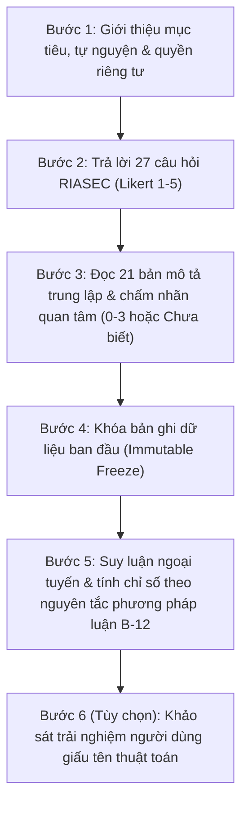

# QUY TRÌNH ĐÁNH GIÁ THỰC TẾ TOP-3 (PILOT FLOW)
*(Đề xuất phương pháp luận phục vụ chuẩn bị nghiên cứu trong tương lai)*

Tài liệu này xác lập quy trình thao tác chuẩn (SOP) 6 bước được đề xuất nhằm thu thập nhãn sở thích độc lập và đánh giá khách quan hai thuật toán P0 và P2 dựa trên các nguyên tắc phương pháp luận của B-12.

> [!WARNING]
> **Ranh giới công cụ kỹ thuật B-12**:
> - Công cụ B-12 hiện tại ([evaluate_top3.py](file:///c:/Users/DELL/OneDrive/Máy%20tính/labanAI/research/riasec27_top3_validation_v1/evaluate_top3.py)) **chỉ chấp nhận dữ liệu giả lập** (`SYNTHETIC_DEMO_ONLY — NOT_SCIENTIFIC_VALIDATION`) và sẽ báo lỗi nếu nhận dữ liệu khác.
> - Tuyệt đối **không đưa dữ liệu học sinh thật trực tiếp vào công cụ B-12** và **không được dán nhãn dữ liệu thật thành synthetic** để lách qua cổng kiểm định.
> - Quy trình 6 bước dưới đây là **đề xuất vận hành cho giai đoạn thực nghiệm chính thức** (khi đã có phê duyệt đạo đức và công cụ nghiên cứu thực tế có thẩm quyền).

---

## SƠ ĐỒ QUY TRÌNH TỔNG QUAN

---

## CHI TIẾT TỪNG BƯỚC THỰC HIỆN

### BƯỚC 1: GIỚI THIỆU MỤC TIÊU NGHIÊN CỨU, TÍNH TỰ NGUYỆN VÀ QUYỀN RIÊNG TƯ
- **Mục tiêu**: Thiết lập sự đồng thuận minh bạch từ người học và phụ huynh (đối với học sinh dưới 18 tuổi).
- **Hành động cụ thể**:
  1. Giới thiệu rõ ràng: Đây là nghiên cứu khoa học đánh giá công cụ hỗ trợ định hướng ngành học, không phải là kỳ thi tuyển sinh và không ảnh hưởng đến kết quả học tập.
  2. Nêu rõ tính tự nguyện: Người học có quyền từ chối tham gia hoặc dừng lại bất kỳ lúc nào mà không cần giải thích lý do.
  3. Quyền riêng tư tuyệt đối: Chỉ cấp phát mã định danh ngẫu nhiên chuẩn UUIDv4 (`participant_id`). Tuyệt đối không thu thập họ tên, email, số điện thoại, địa chỉ, tên trường, lớp học hay điểm học bạ.

### BƯỚC 2: NGƯỜI HỌC TRẢ LỜI 27 CÂU HỎI RIASEC
- **Mục tiêu**: Thu thập vector sở thích nghề nghiệp 27 chiều theo đúng chuẩn `FEATURE_ORDER_27`.
- **Hành động cụ thể**:
  1. Người học phản hồi 27 câu hỏi RIASEC trên thang đo Likert 1–5 (1: Rất không thích $\to$ 5: Rất thích).
  2. Toàn bộ 27 câu trả lời được kiểm tra tính hợp lệ: đủ 27 câu, không có giá trị khuyết, không có giá trị ngoài khoảng $[1, 5]$.

### BƯỚC 3: ĐỌC 21 BẢN MÔ TẢ TRUNG LẬP VÀ TỰ ĐÁNH GIÁ MỨC ĐỘ QUAN TÂM
- **Mục tiêu**: Thu thập nhãn quan tâm ngành học độc lập làm căn cứ so sánh khách quan.
- **Quy tắc bắt buộc**:
  1. **Tuyệt đối chưa hiển thị gợi ý**: Người học hoàn toàn chưa nhìn thấy kết quả Top-3 từ P0 hay P2.
  2. **Tài liệu tham khảo**: Người học đọc các bản giới thiệu ngắn gọn, trung lập về nội dung học tập và hoạt động cốt lõi của 21 ngành `READY_FOR_PROTOTYPE` (trích xuất từ bộ mô tả B-09 dưới dạng DRAFT).
  3. **Thang đo mức độ quan tâm**:
     - `0`: Không quan tâm
     - `1`: Ít quan tâm
     - `2`: Quan tâm
     - `3`: Rất quan tâm
     - `null`: Chưa biết đủ thông tin / không thể đánh giá
  4. **Giảm thiểu thiên lệch trình bày (Order Bias)**: Thứ tự 21 ngành hiển thị cho người học phải được ngẫu nhiên hóa (randomized) hoặc cân bằng luân phiên (counterbalanced) giữa các người học để tránh hiện tượng mệt mỏi nhận thức khiến các ngành cuối bảng bị đánh giá thấp.
  5. **Không ép buộc**: Người học hoàn toàn có quyền chọn "Chưa biết đủ thông tin" đối với những ngành chưa hiểu rõ.
  6. **Không tự ý gán nhãn khuyết**: Tuyệt đối không tự suy diễn lựa chọn "Chưa biết đủ thông tin" (null) là "Không quan tâm" (0).

### BƯỚC 4: KHÓA BẢN GHI ĐÁNH GIÁ BAN ĐẦU (DATA FREEZING)
- **Mục tiêu**: Bảo đảm tính toàn vẹn và bất biến của dữ liệu đánh giá trước khi thực hiện suy luận.
- **Hành động cụ thể**:
  1. Bản ghi gồm đúng 3 trường: `participant_id` (UUIDv4), `answers` (27 câu), `major_interest_labels` (21 ngành).
  2. Ghi nhận dấu thời gian (timestamp) và khóa bất biến (read-only/hash-sealed).
  3. Sau thời điểm này, không có bất kỳ thao tác chỉnh sửa nào được phép tác động lên nhãn hoặc câu trả lời.

### BƯỚC 5: SUY LUẬN NGOẠI TUYẾN VÀ TÍNH CHỈ SỐ THEO PHƯƠNG PHÁP LUẬN B-12
- **Mục tiêu**: Tính toán các chỉ số chất lượng xếp hạng một cách khách quan trên môi trường nghiên cứu độc lập.
- **Quy tắc thực hiện**:
  1. **Tách biệt môi trường**: Khi nghiên cứu thực tế được cấp phép, dữ liệu pilot thật sẽ được phân tích bởi công cụ đánh giá chính thức có thẩm quyền. Công cụ B-12 hiện tại được khóa cứng chỉ dành cho kiểm thử dữ liệu giả lập (`SYNTHETIC_DEMO_ONLY`). Tuyệt đối không đưa dữ liệu thật vào B-12 hoặc sửa cờ `data_kind` thành synthetic để chạy lách luật.
  2. **Áp dụng chuẩn toán học B-12**:
     - Chạy độc lập hai thuật toán P0 và P2 trên cùng vector 27 câu trả lời.
     - Với các hồ sơ có đủ 21 nhãn quan sát được và cả hai thuật toán trả về `SUCCESS`:
       * $NDCG@3$ cho P0 và P2 (IDCG@3 tính trên toàn bộ 21 ngành quan sát được; trường hợp IDCG@3=0 gán NDCG=0.0 và báo cáo riêng).
       * $Precision@3$ và $Hit@3$ (ngưỡng quan tâm nhị phân $\text{rel} \ge 2$).
       * Chênh lệch theo cặp: $\Delta \text{NDCG@3} = \text{NDCG@3}(P2) - \text{NDCG@3}(P0)$.
  3. **Báo cáo minh bạch**: Phân loại và báo cáo riêng các hồ sơ không đủ điều kiện (`INSUFFICIENT_LABELS`, `NON_SUCCESS`, `INVALID_INPUT`).

### BƯỚC 6 (TÙY CHỌN): KHẢO SÁT TRẢI NGHIỆM NGƯỜI DÙNG GIẤU TÊN THUẬT TOÁN
- **Mục tiêu**: Đánh giá trải nghiệm thực tế của người học khi tiếp nhận hai danh sách gợi ý.
- **Quy tắc bắt buộc**:
  1. **Giấu tên thuật toán (Double-Blind Presentation)**: Hiển thị hai danh sách gợi ý dưới tên gọi trung lập (ví dụ: "Danh sách gợi ý A" và "Danh sách gợi ý B").
  2. **Cân bằng thứ tự hiển thị**: Phân bổ ngẫu nhiên 50% người học thấy P0 là A (P2 là B) và 50% người học thấy P2 là A (P0 là B).
  3. **Bộ câu hỏi trải nghiệm**:
     - *Tính dễ hiểu*: Danh sách nào có phần giải thích rõ ràng hơn?
     - *Mức độ hữu ích*: Danh sách nào gợi mở thêm những hướng đi mới mẻ, phù hợp hơn?
     - *Mức độ ưu tiên tổng thể*: Người học tin tưởng và muốn tìm hiểu sâu hơn về danh sách nào?
  4. **Tách biệt dữ liệu**: Toàn bộ phản hồi ở Bước 6 phải được lưu trữ trong một bảng dữ liệu riêng biệt. Tuyệt đối không được hòa trộn hoặc dùng câu trả lời ở Bước 6 để hiệu chỉnh nhãn mức độ quan tâm ban đầu đã khóa ở Bước 4.
